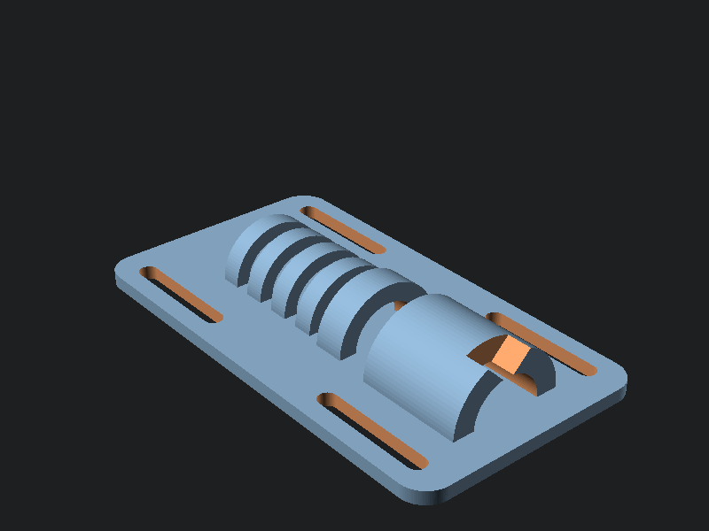

# Parametric cricothyrotomy trainer

Half-shell larynx and trachea mounted on a strap plate. Wear it on a forearm or on the neck of a role-player, or strap it to a table edge. The cricothyroid membrane position is an open window in the print; the consumable skin layer over it is what gets cut.

## Landmarks built in

- Thyroid cartilage with a superior V-notch (laryngeal prominence)
- Open cricothyroid membrane window (8 mm) between thyroid and cricoid
- Cricoid ring printed slightly proud so it palpates as a distinct step
- Four tracheal rings below, with an open 16 mm lumen for passing a tube or bougie

## Print

PLA or PETG, 0.2 mm layers, 3 or more perimeters, no supports; the model prints flat. PETG survives scalpels longer.

## Assemble and run

1. Thread 25 mm webbing or velcro through the four slots.
2. Build the consumable skin: two or three layers of cloth tape, or Press'n Seal over a 3-5 mm foam sheet, stretched across the membrane window and the structures beside it. The trainee should have to find the membrane by feel, not by sight.
3. Replace the skin layer between trainees. The print itself survives many sessions.

Technique sequence is the instructor's call; this model gives the hands realistic landmarks and a lumen that confirms correct placement.

## Remix

`cric_trainer.scad` is fully parametric: lumen diameter, ring sizes, membrane gap, and plate dimensions are named variables at the top of the file. A pediatric or small-adult variant is a two-line edit.
