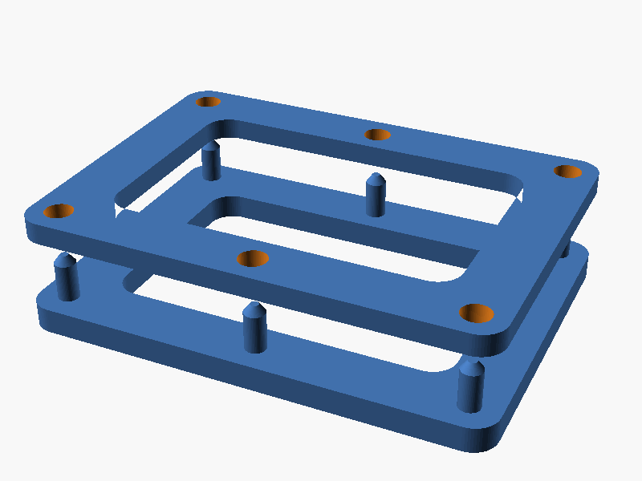

# Suture practice tension frame

Two-part clamping frame that holds any skin analog under tension, because sutures only behave realistically in a membrane that pulls back. Swap the membrane in seconds and keep the frame forever.

## Print

`suture_frame_base.stl` and `suture_frame_top.stl`, one each. PLA, 3 perimeters, no supports.

## Use

1. Stretch the analog over the base frame's posts: cut-open nitrile glove (cheap, everywhere), silicone sheet, bicycle inner tube (tough skin), thin craft foam, or chicken skin for tissue fidelity.
2. Press the top frame down; the cone-tipped posts pierce and lock the membrane.
3. Cut a "wound" in the stretched membrane and close it. The tension makes edge eversion, spacing, and knot security behave the way skin does.

Layering works too: foam under glove rubber gives a subcutaneous layer for deep-dermal practice.

## Remix

`suture_frame.scad` parameters set frame size, band width, and post positions. Scale up for a two-student frame or down for a kit-pouch version.
