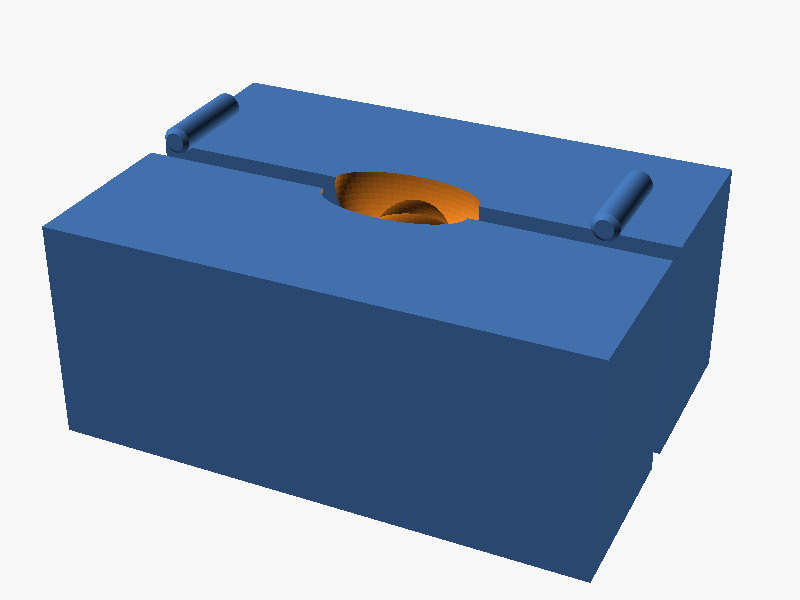

# Wound packing trainer

Two identical halves pin together around a deep wound tract: a narrow skin entry opening into a wide pocket with a lateral extension, which is the geometry that makes packing hard and makes training matter. A bleeder channel runs from the pocket to the end face.

## Print

- `wound_half.stl` twice, `wound_peg.stl` four times
- PLA, 2 perimeters, 10% infill, no supports; halves print lying on the split face

## Run it

1. Pin the halves together.
2. Dry repetitions: pack the tract with gauze until the pocket and lateral extension are filled with pressure on, then strip and repeat. The lateral extension punishes lazy packing: a sweep that misses it leaves dead space.
3. Bleeding model: run 6 mm OD surgical tubing through the bleeder channel into the pocket, connect an IV bag of water (add red food coloring if wanted) and let it drip or squeeze. Packing with correct pressure stops the flow at the source; packing that misses lets it keep welling up.
4. Open the halves to clean, dry, or reline the tract with a thin gelatin pour for soft-tissue feel.

## Remix

`wound_trainer.scad` parameters set block size, tract shape, pocket size, and the bleeder diameter. A junctional variant is mostly a deeper block with a longer tract.
