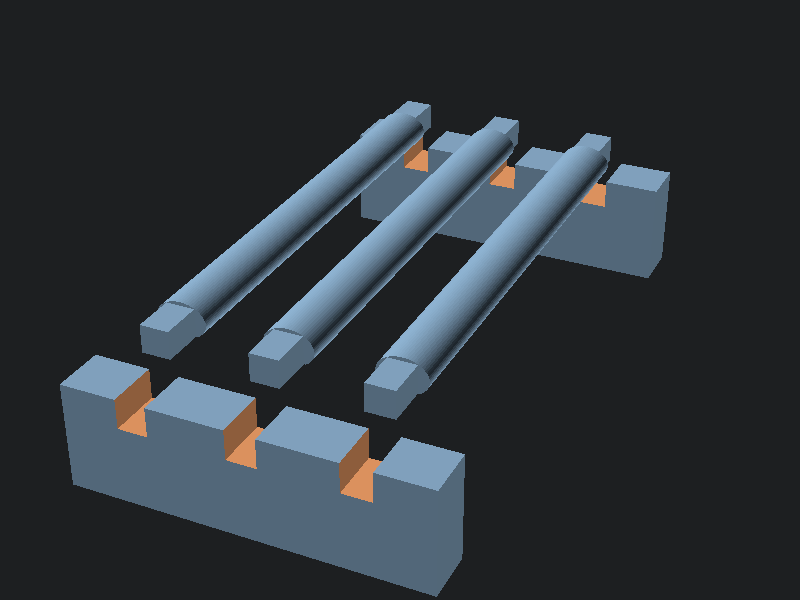

# Rib frame for needle decompression and finger thoracostomy

Three-part press-fit frame: two rails and three elliptical rib bars. The space under the ribs stays open, so a needle or finger that clears the chest wall correctly passes into free air, the "pleural space." Cover the frame with foam, gelatin, or pork belly as the chest wall.

## Print

Print `rib_rail.stl` twice and `rib_bar.stl` three times. PLA, 3 perimeters, no supports; every part prints flat. Press the rib pegs into the open-top rail slots.

## Geometry

Ribs are 14 mm wide with 16 mm intercostal gaps at a 30 mm pitch, sized so fingers can sweep over a rib edge and needles pass the intercostal space with room to teach "over the superior border of the rib" against the inferior-border neurovascular bundle.

## Run it

1. Assemble the frame and lay 15-20 mm of covering: upholstery foam for cheap repetitions, ballistic gelatin for ultrasound work, pork belly for tissue fidelity.
2. For needle decompression, a catheter that reaches open air under the ribs is a confirmed "pleural" entry; one that stops in a rib or the covering is not.
3. For finger thoracostomy, the gap accepts a gloved finger after blunt dissection through the covering.

Covering is the consumable; the frame survives indefinitely and disassembles flat for a kit bag.

## Remix

`rib_frame.scad` parameters cover rib width, pitch, count, and rail size. Render with `part="rail"` or `part="rib"`; the default shows the assembled layout.
