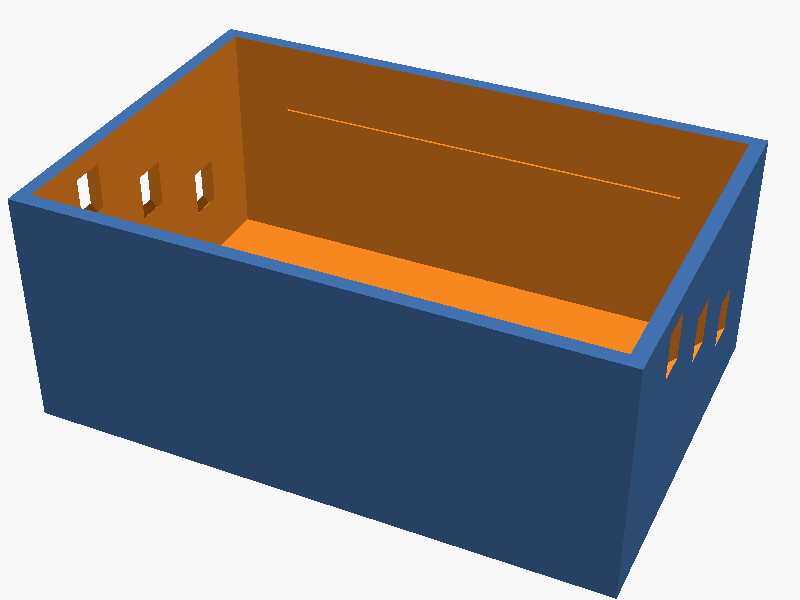

# Vessel phantom mold box

Open-top box with V-notches on both end walls at three staggered depths. One pour gives a phantom with vessels at roughly 10, 20, and 30 mm below the surface: superficial IV, deep IV, and central-line depth in a single block.

## Print

PLA or PETG, 3 perimeters, no supports; prints upright as oriented. PETG tolerates hot gelatin pours better.

## Build the phantom

1. Lay tubing across matching notches on each end wall. Water-filled and tied off compresses like a vein; filled stiff (or thicker-walled tubing) reads more arterial.
2. Mix gelatin: 100 g gelatin, 900 mL water, 20 g flour per batch. The flour sets echogenicity so tissue reads correctly on ultrasound.
3. Pour to the engraved line inside the long walls, degas bubbles with gentle stirring, and refrigerate.
4. Scan and stick through the top surface. When the block gets too tracked up, melt it down and re-pour; the box and tubing are reusable indefinitely.

## Remix

`mold_box.scad` has box dimensions and the lane list (position and depth per vessel) as parameters. Add lanes for a busier phantom or deepen the box for pediatric-to-adult depth ranges.
