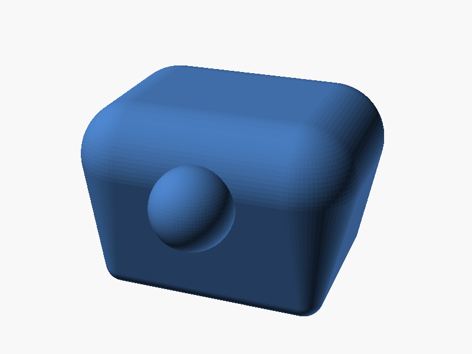

# Intraosseous (IO) trainer, proximal tibia block

Stylized proximal tibia block for IO insertion practice. The slicer, not the geometry, creates the bone feel: perimeters act as cortex, sparse infill as cancellous bone.

## Print

- 2 perimeters (this is the "cortex"; 3 makes a thicker, older-feeling cortex)
- 8-12% gyroid or cubic infill (the "cancellous" space)
- PLA gives the most convincing crunch-and-give; no supports needed

## Use

Palpate the tuberosity bump on the anterior face, move medial and slightly distal, and drive the needle on the flat medial surface, exactly as the landmark sequence teaches. Any spot on the upper medial face works, so one block takes dozens of insertions. Reprint when it looks chewed up; a block costs roughly 50 g of filament at these settings.

## Remix

`io_trainer.scad` has block dimensions and tuberosity position as parameters. Scale down for a pediatric block, or print a pair for bilateral setups.
